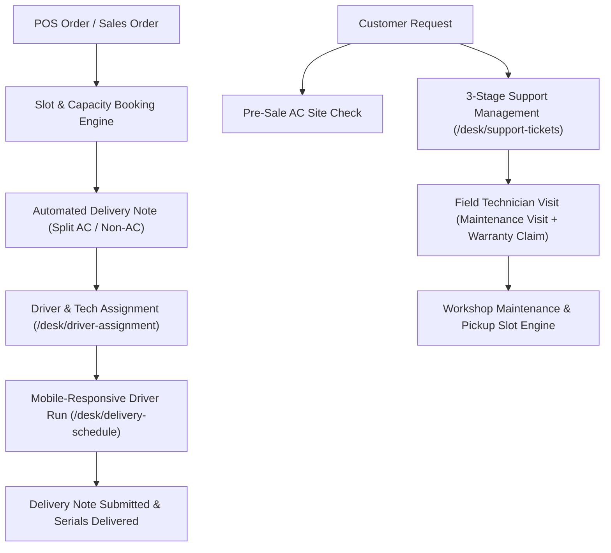
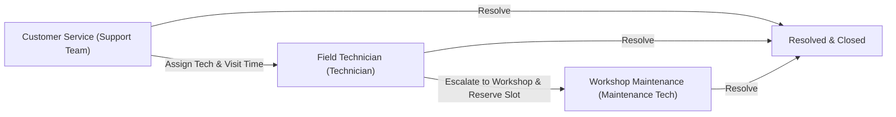

# Delivery Management System for Frappe & ERPNext v16

[](https://frappeframework.com/)
[](https://erpnext.com/)
[](https://opensource.org/licenses/MIT)

An enterprise-grade, high-concurrency Delivery, Installation, Driver Dispatch, and Multi-Stage Support Management application built natively on **Frappe Framework v16** and **ERPNext v16**. 

Engineered for retail enterprises dealing with high-volume point-of-sale orders, central warehousing, serialized electronics (TVs, Home Appliances), and capacity-constrained installations (Air Conditioners), seamlessly replacing legacy standalone dispatch and support systems.

---

## 🌟 Key Functional Pillars



---

## 🚀 Core Features & Capabilities

### 1. High-Concurrency Slot & Capacity Engine
* **Dual-Capacity Architecture**:
  * **Delivery Slot Capacity**: Area-based routing (`Delivery Area`) constrained by available vehicle count (`cars_number`) and weekly operational windows (`Delivery Work Hour`).
  * **AC Installation Capacity**: Dedicated daily load limits calculated by actual physical AC tonnage/units (e.g., an order with three 2-Ton units consumes 3 AC units against the daily technician quota).
* **Ledger-Backed Accuracy (`Delivery Slot Reservation`)**:
  * Pure ledger architecture serving as the absolute source of truth.
  * Deterministic naming and row-level database locking (`SELECT ... FOR UPDATE`) prevent race conditions and overbooking even under simultaneous POS checkouts.
  * Complete support for atomic rescheduling, cancellations, and capacity recalculation on schedule changes.

### 2. POS Integration & Automated Fulfilment (POS Awesome V15)
* **Invoice vs. Order Mode**:
  * **Invoice (Takeaway / Branch Pickup)**: Immediate fulfillment from the local branch store with `update_stock = 1`.
  * **Order (Delivery / Scheduled Installation)**: Fulfillment routed through the central main warehouse (`Stores - SHD`) with `update_stock = 0`.
* **Zero-Collision Serial Number Lifecycle**:
  * **FIFO Automated Reservation**: The server automatically allocates the oldest available serial numbers upon order placement and marks them `Inactive` (reserved).
  * Outward transaction guards prevent duplicate allocation across Sales Orders, draft Delivery Notes, and manual Stock Entries.
  * When a Delivery Note is submitted, serial numbers are automatically marked as `Delivered`. If an order is cancelled, reservations are immediately released.
* **Intelligent Cart Rules & Product Bundles**:
  * Automated delivery charge injection (preventing duplicate or manual charges).
  * Transparent resolution of multi-component product bundles (e.g., TV + Bracket, Split AC + Piping Kit) with per-component stock and capacity evaluation.

### 3. Automated Delivery Note Splitting & Dispatch
* **Automated Creation from Sales Orders**: Seamlessly hooks into `Sales Order.on_submit` using ERPNext native mappers to generate draft Delivery Notes without requiring legacy server scripts.
* **Mixed Order Splitting**:
  * Automatically separates combined customer orders into two distinct Delivery Notes:
    1. **AC Delivery Note**: Assigned to certified air conditioning installers (`AC Tech`) for the installation date.
    2. **Non-AC Delivery Note**: Assigned to delivery drivers (`TV Driver`) for standard vehicle delivery slots.

### 4. Driver Assignment & Mobile-Responsive Execution
* **Driver Assignment Desk (`/desk/driver-assignment`)**:
  * Real-time dashboard for dispatchers to review pending deliveries, inspect customer locations, and assign drivers.
  * Built-in clash prevention: enforces minimum travel buffers (e.g., 30–60 min gap) and daily AC installation limits with calendar-based days off.
* **Mobile Driver Portal (`/desk/delivery-schedule`)**:
  * Designed specifically for mobile screens used by drivers on the road.
  * One-tap calling to customer phones and direct navigation links to Google Maps.
  * Digital customer signature capture attached directly to the Delivery Note.
  * Photographic proof of delivery attachments.
  * Direct payment collection logging (`Payment Entry` creation with outstanding balance validation).
  * Direct submission of Delivery Notes upon delivery completion.

### 5. Multi-Stage Support & Field Service Management
A complete port and modernization of the multi-tier support workflow:



* **Standard Issue Extension**: Built directly on ERPNext's standard `Issue` doctype using `sm_*` custom fields.
* **Stage 1: Customer Service (`/desk/support-tickets`)**:
  * Instant customer lookup by phone number, displaying historical sales invoices, delivery notes, and delivered serials.
  * Ticket creation with mandatory customer service reports and visit scheduling.
  * Real-time technician availability inspection with clash detection.
* **Stage 2: Field Technician (`/desk/technician-issues`)**:
  * Technicians view their assigned on-site service appointments.
  * Visit logging automatically generates an ERPNext **`Maintenance Visit`** and, if the serialized asset is under active warranty, automatically registers an ERPNext **`Warranty Claim`**.
  * Ability to escalate tickets to workshop maintenance while simultaneously reserving a pickup delivery slot.
* **Stage 3: Maintenance Technician / Workshop (`/desk/maintenance-issues`)**:
  * Workshop technicians conduct bench diagnostics and write the final maintenance report.
* **Automated Resolution**: Resolving a ticket automatically closes all associated warranty claims and records the resolving user and timestamp.

### 6. AC Pre-Sale Site Checks (`AC Site Check`)
* Pre-sales on-site evaluation doctype (`ACSC-.YYYY.-#####`).
* Technicians visit prospective properties prior to purchase to inspect rooms, measure dimensions, and recommend appropriate AC tonnage/models.
* Automatically creates or updates customer addresses in ERPNext.

### 7. Performance & Sales Analytics
* **Sales Statistics Desk (`/desk/sales-statistics`)**:
  * Evaluates commission and sales volume based on PIN-verified cashiers (`posa_cashier`) across paid invoices.
  * Background queue execution (`long` worker) with real-time push updates via Frappe websocket events.
  * Granular breakdown of AC units, general units, returns, and commission totals with CSV export.
* **Installation Statistics Desk (`/desk/installation-statistics`)**:
  * Tracks submitted delivery notes and installation output per driver and technician.

---

## 🛠 Tech Stack & Architecture

* **Backend**: Python 3.12+ / 3.14, Frappe Framework v16, ERPNext v16.
* **Database**: MariaDB / MySQL (leveraging row locks, savepoints, and deterministic ledger indexing).
* **Frontend**: Vanilla ES6+ Desk Pages with Frappe UI widgets, Tailwind-inspired design system (`drivers_pages.css`), and POS Awesome V15 (Vue 3, Pinia).
* **Background Jobs**: Frappe Background Workers (`default` and `long` queues).

---

## 📂 App Structure

```text
delivery_management/
├── api/
│   ├── admin.py                # Delivery slots and capacity administration APIs
│   ├── drivers.py              # Driver assignment, schedule run, and statistics APIs
│   ├── pos.py                  # POS Awesome submission, stock verification, and rules
│   ├── sales_stats.py          # Salesman commission & performance analytics endpoints
│   └── support.py              # Multi-stage support ticket endpoints
├── customer_support/
│   ├── doctype/                # Child doctypes (Support Technician Visit)
│   ├── page/                   # Support Tickets, Technician Issues, Maintenance Issues
│   ├── permissions.py          # Role-based query and document permissions
│   └── tickets.py              # Support business logic (Maintenance Visits, Warranty Claims)
├── delivery_management/
│   ├── doctype/                # Delivery Area, Work Hour, Reservation, AC Capacity, etc.
│   ├── page/                   # Desk pages (Delivery Slots, Schedule, Driver Assignment)
│   ├── print_format/           # Custom print formats (POS Invoice Salesman)
│   └── workspace/              # Delivery Management Desk Workspace
├── drivers/
│   ├── assignment.py           # Driver assignment logic, limits, and conflict checking
│   ├── delivery_note.py        # Delivery Note permissions, submission, and validation
│   └── stats.py                # Driver and technician installation metrics
├── orders/
│   ├── address.py              # Address normalization, parsing, and customer assignment
│   ├── delivery_note.py        # Automatic Delivery Note creation and AC/Non-AC splitting
│   ├── sales_order.py          # Sales order validation, before_submit hooks, and slot picker
│   ├── serials.py              # Serial reservation guards and bundle integrity
│   ├── service.py              # End-to-end POS Order submission flow
│   └── stock.py                # Available-to-promise calculations and serial FIFO allocation
├── slots/
│   ├── cart.py                 # Cart classification (AC vs Non-AC vs Accessories)
│   ├── engine.py               # Core slot booking, release, locking, and ledger operations
│   ├── settings.py             # Single DocType settings cache and helpers
│   └── timeutils.py            # Time normalization, lead-time bounds, and timezone helpers
└── tests/                      # Comprehensive test suite covering concurrency, slots, and orders
```

---

## 🔧 Installation & Setup

### Prerequisites
* Frappe Bench with Frappe v16 and ERPNext v16 installed.
* [POS Awesome V15](https://github.com/defendicon/POS-Awesome-V15) installed on your bench (if using POS ordering).

### 1. Get the App
```bash
cd ~/frappe/frappe-bench-16
bench get-app https://github.com/Marwan-badr543/delivery-management-frappe-app.git delivery_management
```

### 2. Install on Site
```bash
bench --site <your-site-name> install-app delivery_management
bench --site <your-site-name> migrate
```

### 3. Build Assets
```bash
bench build --app delivery_management
```

### 4. Configuration
1. Navigate to **Delivery Settings** in ERPNext Desk:
   * Set your **Main Store** (e.g., `Stores - SHD`).
   * Configure **AC Item Groups** and **Excluded Items/Groups**.
   * Configure **Slot Lead Time Hours** and **Booking Window**.
   * Set driver dispatch gaps and support visit gaps.
2. Define your **Delivery Areas** and their respective **Delivery Work Hours**.
3. Assign roles to staff:
   * **Delivery Manager**: Dispatch and capacity oversight.
   * **TV Driver**: Standard delivery drivers.
   * **AC Tech**: Certified AC installation technicians.
   * **Support Team**: Customer service agents handling ticket creation.
   * **Technician**: Field technicians handling service visits.
   * **Maintenance Technician**: Workshop repair personnel.

---

## 🧪 Running Tests

The application includes a comprehensive test suite (140+ unit and integration tests) validating race conditions, serial allocations, split notes, and support stages:

```bash
bench --site <your-site-name> run-tests --module delivery_management.tests.test_slot_engine --skip-before-tests
bench --site <your-site-name> run-tests --module delivery_management.tests.test_orders --skip-before-tests
bench --site <your-site-name> run-tests --module delivery_management.tests.test_drivers --skip-before-tests
bench --site <your-site-name> run-tests --module delivery_management.tests.test_support --skip-before-tests
bench --site <your-site-name> run-tests --module delivery_management.tests.test_sales_stats --skip-before-tests
```

> **Note**: Always pass `--skip-before-tests` to prevent ERPNext's test harness from wiping your price list records during test runs.

---

## 📄 License

This software is released under the [MIT License](LICENSE).